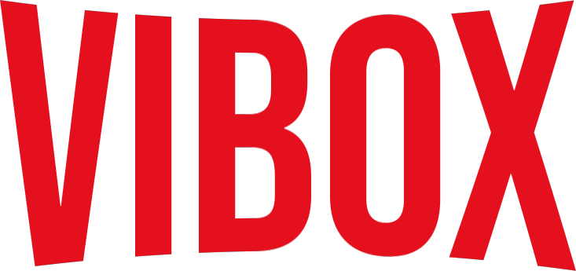

<p align="center">
  
</p>

<p align="center"><b>Pantalla de inicio para Android TV y Google TV, sin anuncios, pensada para Stremio y YouTube.</b></p>

<p align="center">
  <a href="https://github.com/GuilleMos/ViBox-releases/releases/latest/download/ViBox.apk"><b>⬇ Descargar ViBox (última versión)</b></a>
</p>

---

## Qué es ViBox

ViBox sustituye la pantalla de inicio de tu tele por una portada a pantalla completa y filas horizontales
de películas, series y vídeos, sin publicidad, sin recomendaciones patrocinadas y sin servicios en
segundo plano. Es ligera (menos de 2 MB) y arranca al instante incluso en teles modestas.

## Funciones

**Portada**
- Fondo a pantalla completa con la película o serie en tendencia: logo del título, nota, año, géneros y sinopsis.
- Al recorrer las filas, la portada muestra el título que tienes seleccionado.
- Botones *Reproducir* (abre el título directamente en Stremio) y *Más info*.
- Rotación automática entre lo más popular (opcional).

**Filas totalmente configurables**
Desde *Ajustes → Filas de Inicio* puedes ordenar, ocultar, editar, borrar y crear filas. Tipos disponibles:

| Fila | Qué muestra |
| --- | --- |
| Seguir viendo | Lo que tienes a medias en Stremio, con barra de progreso (inicia sesión en Ajustes) |
| Catálogo de Stremio | Populares o mejor valoradas, por género, películas o series. Compatible con cualquier addon de Stremio |
| YouTube: canales | Últimos vídeos de los canales que elijas (`@canal`), sin necesidad de clave |
| YouTube: populares / búsqueda | Tendencias por país o cualquier búsqueda (requiere clave gratuita de YouTube Data API) |
| Mix | Mezcla varias filas en una (por ejemplo, series + YouTube) |
| Mis apps | Tus apps favoritas |

Cada fila puede usar tarjetas de **póster vertical**, **horizontales** o **Top 10 con números grandes**.

**Menú lateral**
- Buscar, Inicio, Películas, Series, Mis apps y Ajustes.
- Accesos directos a tus apps favoritas.

**Mis apps**
- Todas las apps de la tele en una cuadrícula. *OK* abre la app; *mantener OK* la añade o quita de favoritas.

**Búsqueda**
- Busca a la vez películas, series y (con clave) vídeos de YouTube.

**Apariencia** (*Ajustes → Apariencia*)
- Tamaño de tarjetas: pequeño, normal o grande.
- Nota en la portada: «% para ti», nota IMDb u oculta.
- Color de acento: rojo, azul, verde, morado o naranja.
- Portada fija o que sigue al título seleccionado, con o sin sinopsis.
- Mostrar u ocultar las apps en el menú lateral.

**Otros**
- Sinopsis y títulos en español con una clave gratuita de TMDB (opcional).
- Los vídeos de YouTube se abren en SmartTube o en la app de YouTube, a tu elección.
- Actualizaciones automáticas: ViBox avisa cuando hay versión nueva y se actualiza con un clic.
- Al encender muestra al instante el último contenido guardado y lo actualiza en segundo plano.

## Instalación

### Opción A — Desde la propia tele (con la app Downloader)
1. Instala **Downloader** desde Google Play en la tele.
2. En Ajustes de la tele, permite a Downloader *instalar apps desconocidas*.
3. Abre Downloader y escribe esta dirección:
   `https://github.com/GuilleMos/ViBox-releases/releases/latest/download/ViBox.apk`
4. Instala y abre ViBox.

### Opción B — Desde un ordenador con ADB
1. En la tele: *Ajustes → Sistema → Información → Compilación*, pulsa **OK 7 veces**.
   Después activa *Opciones de desarrollo → Depuración USB*.
2. Descarga [Android SDK Platform-Tools](https://developer.android.com/tools/releases/platform-tools) y el APK de ViBox.
3. En una terminal, dentro de la carpeta de platform-tools (en Mac usa `./adb`):
   ```
   adb connect IP_DE_TU_TELE
   adb install -r ViBox.apk
   ```

## Que el botón Home abra ViBox (Google TV)

Google TV no deja elegir otra pantalla de inicio, así que hay que desactivar la suya con ADB.
**Abre ViBox al menos una vez antes de hacerlo.**

```
adb shell pm disable-user --user 0 com.google.android.apps.tv.launcherx
adb shell pm disable-user --user 0 com.google.android.tungsten.setupwraith
adb shell cmd package set-home-activity com.vibox.launcher/.MainActivity
```

> Hay que desactivar **los dos** paquetes. Si solo se desactiva el primero, Google TV abre un asistente
> oculto al pulsar Home y la tele parece congelada.

**Para volver a la pantalla de Google TV:**

```
adb shell pm enable com.google.android.apps.tv.launcherx
adb shell pm enable com.google.android.tungsten.setupwraith
```

En **Android TV** clásico (sin Google TV) normalmente basta con pulsar Home y elegir ViBox → *Siempre*.

## Primeros pasos

1. **Ajustes → Cuenta de Stremio**: inicia sesión para ver *Seguir viendo*.
2. **Ajustes → Filas de Inicio → YouTube → editar**: escribe tus canales, por ejemplo `@canal1, @canal2`.
3. **Mis apps**: mantén OK sobre tus apps habituales para tenerlas en el menú.
4. Opcional: claves de **TMDB** (sinopsis en español) y **YouTube Data API** (filas de populares y búsqueda).

## Requisitos

- Android TV o Google TV con Android 6.0 o superior.
- [Stremio](https://www.stremio.com/) instalado para reproducir películas y series.
- SmartTube o YouTube para los vídeos de YouTube.

## Preguntas frecuentes

**¿ViBox tiene contenido propio?**
No. ViBox es solo una pantalla de inicio: muestra catálogos públicos (Cinemeta, el catálogo oficial de
Stremio, y feeds públicos de YouTube) y abre el contenido en las apps que tengas instaladas.

**¿Guarda mi contraseña de Stremio?**
No. Solo guarda el token de sesión en la tele.

**Las sinopsis salen en inglés.**
Añade una clave gratuita de TMDB en *Ajustes → Sinopsis en español*.

**¿Cómo actualizo?**
ViBox avisa sola. También puedes ir a *Ajustes → Actualizaciones*. La primera vez Android te pedirá
permitir *Instalar apps desconocidas* para ViBox.

---

<sub>ViBox es un proyecto personal sin relación con Netflix, Stremio, Google ni YouTube. Todas las marcas pertenecen a sus propietarios.</sub>
